---
# Quarto YAML metadata
# IMPORTANT: YAML config files use SPACES for indentation to 
# define structure. Remember: STRAIGHTEN all smart quotes and don't
# capitalise metadata keys, they MUST BE lowercase! 
# Tip: use "Show Invisibles" in Scrivener to see whitespaces.
# 
# Metadata is used to define the options that Quarto/Pandoc
# use when generating the final document. You will need to change
# the location of your bibliography files and change any fonts
# to those present on your system.
#
title: The Flattened Fauna Index
subtitle: actionable data to inform and track mitigations
format:
  clean-revealjs:
    self-contained: true  
    preview-links: auto
    menu:
      side: right
      width: wide
    title-slide-attributes:
      data-background-image: "Assets/roo_flat.png"
      data-background-size: "cover"
author:
  - name: Garry Jolley-Rogers 
    email: garry@jolley-rogers.id.au
    orcid: 0000-0002-5029-2975
    affiliations: Biodiversity Bioinformatician
  - name: Helena Bender
    orcid: 0000-0003-3424-0494
    email: hbender@unimelb.edu.au
    affiliations: University of Melbourne
date: last-modified
bibliography: refs.bib
---

## Acknowledgement of country { background-color="#343434"}

:::: {.columns}

::: {.column style="width: 70%; font-size: 65%;    "}
 
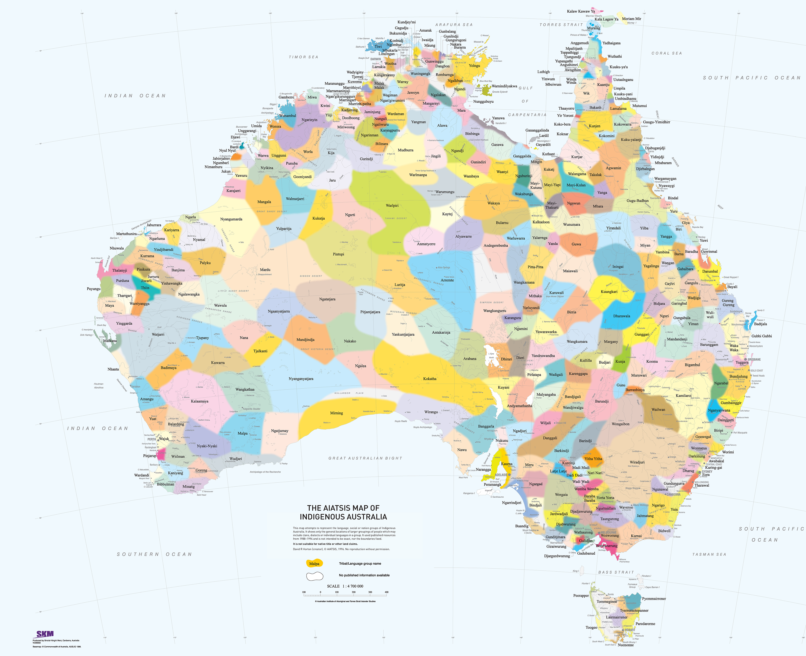

:::
 
::: {.column style="width: 30%; font-size: 65%;    "}

[© AIATSIS Map of Australia](https://shop.aiatsis.gov.au/products/the-aiatsis-map)

Australian Indigenous Language Groups
:::
::::
 
 

## Currently. We don't know.  { background-color="#343434"}

:::: {.columns}

::: {.column style="width: 35%; font-size: 65%;    "}
The data is

* limited 
    * Spatially   
    * Taxonomically 
    * Socially 

5 Million/year [@Schwatz] 
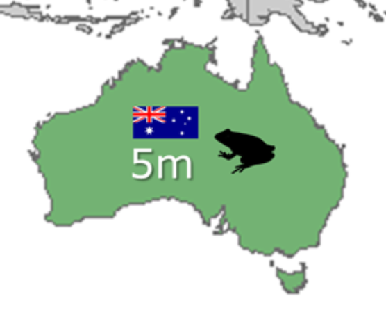

:::
 
::: {.column style="width: 60%; font-size: 65%;    "}

* Incomplete
* incommensurate
* effort restricted in duration or intensity

10 million/year [@Englefield]  and [@conversation2024wildlife] 
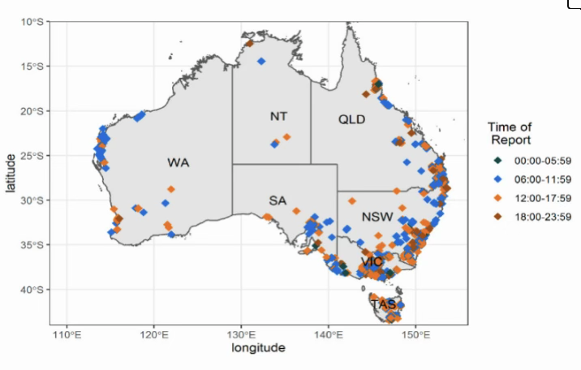

:::
::::
 
 

## Currently under-reported { background-color="#343434"}

:::: {.columns}

::: {.column style="width: 45%; font-size: 80%;    "}
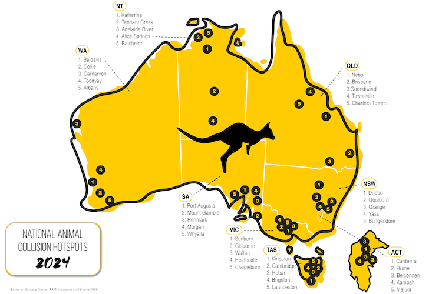 
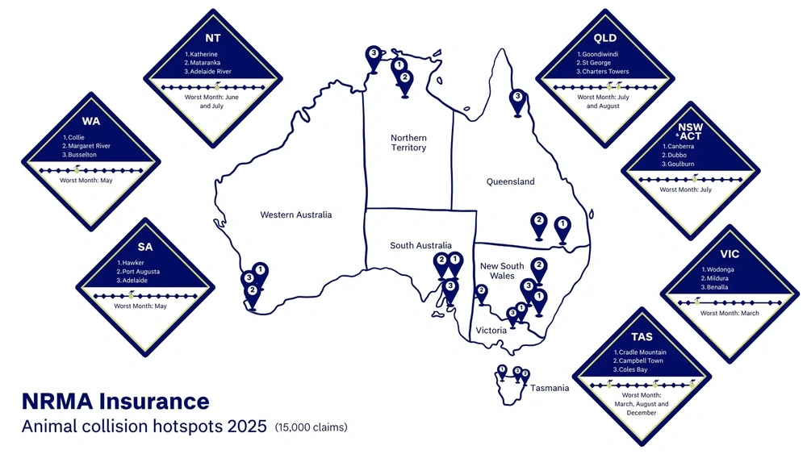  

:::
::: {.column style="width: 55%; font-size: 80%;    "}

[@aami2026report] 

* 24,000 claims
* 41%  of   drivers report having hit an animal 

[@nrma2026report] 

* 15,000 claims
* urban and peri-urban bias 
* taxonomic bias in claims exclude millions of 
    * birds 
    * reptiles
    * invertebrates
    * smaller mammals   [@Englefield] 

:::

 

::::

## An unwelcome Legacy... { background-color="#343434"}

:::: {.columns}

::: {.column style="width: 75%; font-size: 80%;    "}
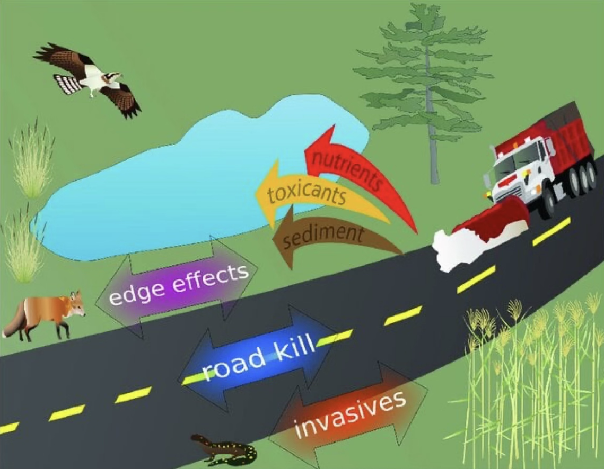 
 
:::
::: {.column style="width: 20%; font-size: 80%;    "}

 
:::

 

::::

## A simple question in the senate... { background-color="#343434"}

::: {style="text-align: right;"}
 that could not be answered
:::

:::: {.columns}
::: {.column style="width: 60%; font-size: 80%;    "}

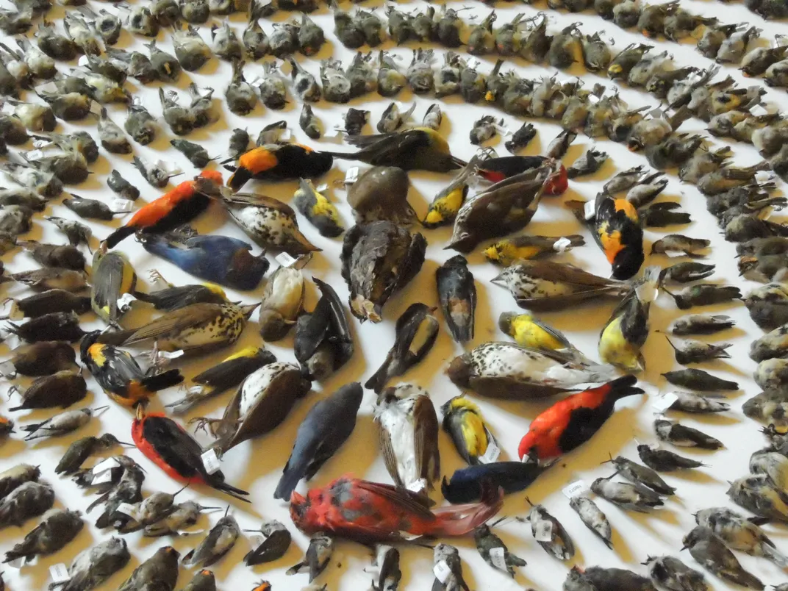
:::
::: {.column style="width: 40%; font-size: 80%;    "}

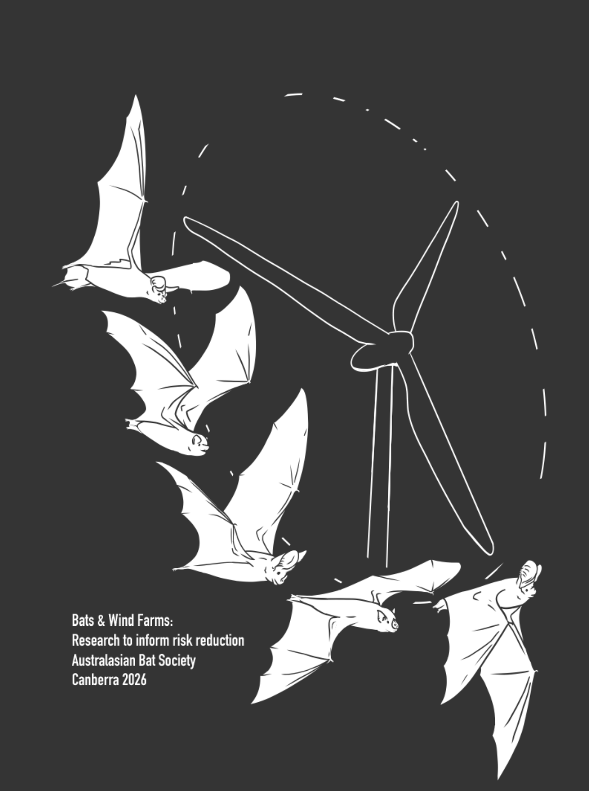
:::

::::
 

## Inspiration ....   { background-color="#E2DDC6"}

::: {style="text-align: right;"}
 other aggregators
:::

:::: {.columns}

::: {.column style="width: 50%; font-size: 80%;    "}
{width="500"}
:::

::: {.column style="width: 40%; font-size: 80%;    "}
 

 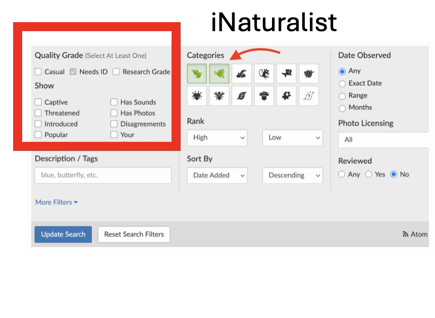{width="400"}
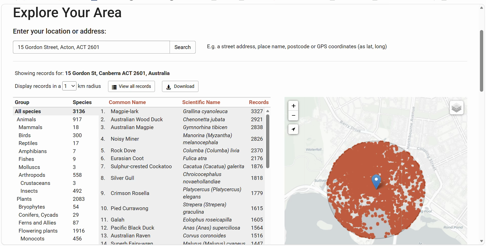{width="400"}

:::
 
::: {.column style="width: 10%; font-size: 80%;    "}
 

:::

::::

## The Flattened Fauna Index  { background-color="#fbf8f0"}

::: {.columns}

::: {.column style="width: 70%; font-size: 80%;"}
seeks to provide  ongoing measures of the impact of

* human activities on the sustainability of wildlife populations
* wildlife on human property, health, and lives

::: {#fig-elephants layout-ncol=2 layout-valign="top"} 

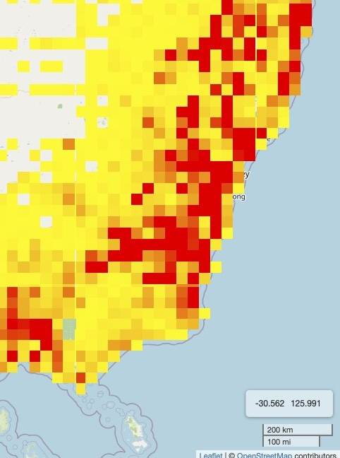{width="300"}

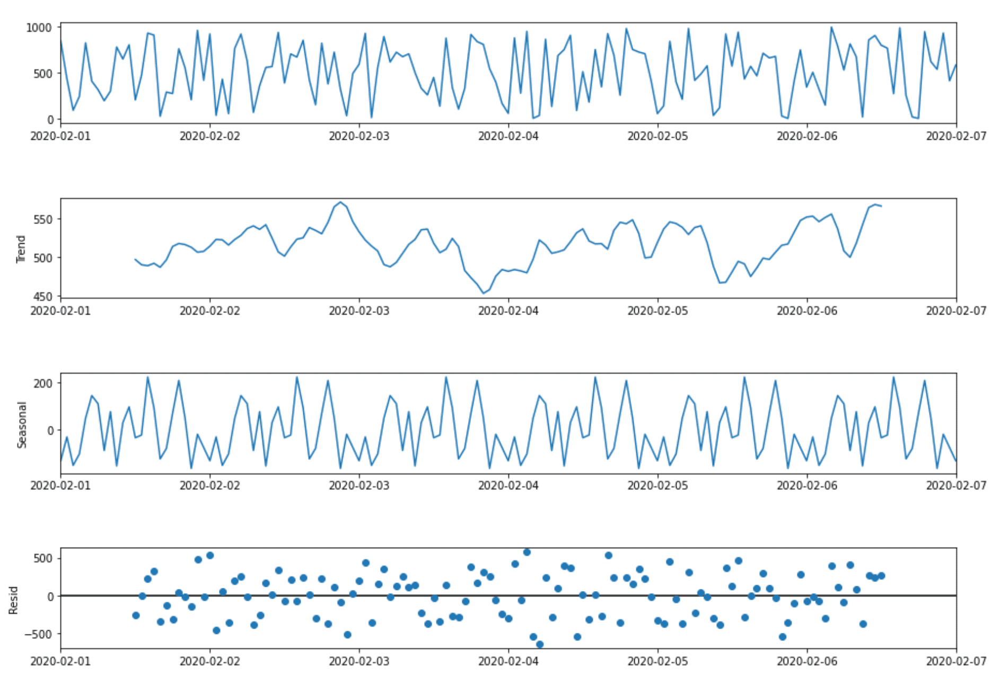{width="300"}
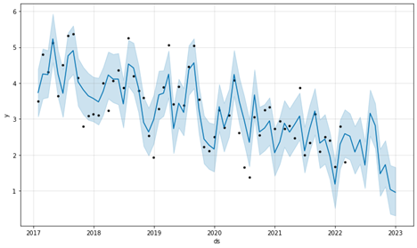{width="300"}

Mockupsx
:::

:::
::: {.column width="4%"}
:::
::: {.column  style="width: 20%; font-size: 75%;  border-left: 3px solid #0066cc;   padding-left: 15px;            margin-left: 10px;   "}
Through the aggregation of data from many sources.

### [Indexed]{style="color: red;"}

* nationally
* regionally
* geospatially   

### [providing]{style="color: red;"}
- national and local trends
- baseline data for potential _mitigations_.
:::

:::

## ACT  Gov. Wildlife incident locations 

::: {.panel-tabset}

### 2016-2026
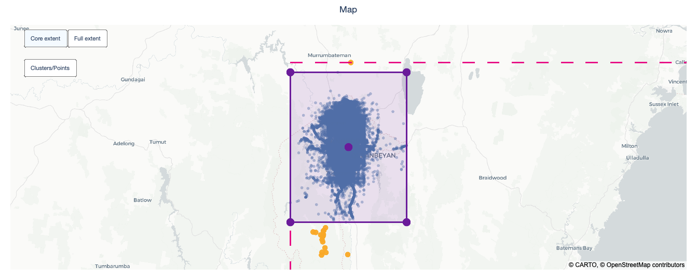 

### Zoomed 
 

### Live
[Link](file:///Users/gjr/Documents-working/1.Projects/1.2-Research/1.2-2024-FFX/NSW_FFX/NSW%20Wildlife%20Q.md/Assets/WildlifeAnal.html){preview-link="true"}

:::
 
  
::: aside
Quickly made using qsv. No refinements. Only location, date, and species available publicly.
:::
 

## ACT Gov Wildlife Vehicle collision reports

::: {.panel-tabset}

### 2016-2026
 

### Report 
 


### Live
[webapp](file:///Users/gjr/Documents-working/1.Projects/1.2-Research/1.2-2024-FFX/NSW_FFX/NSW%20Wildlife%20Q.md/Assets/CrashAnal.html){preview-link="true"}

###  Penn. WVC
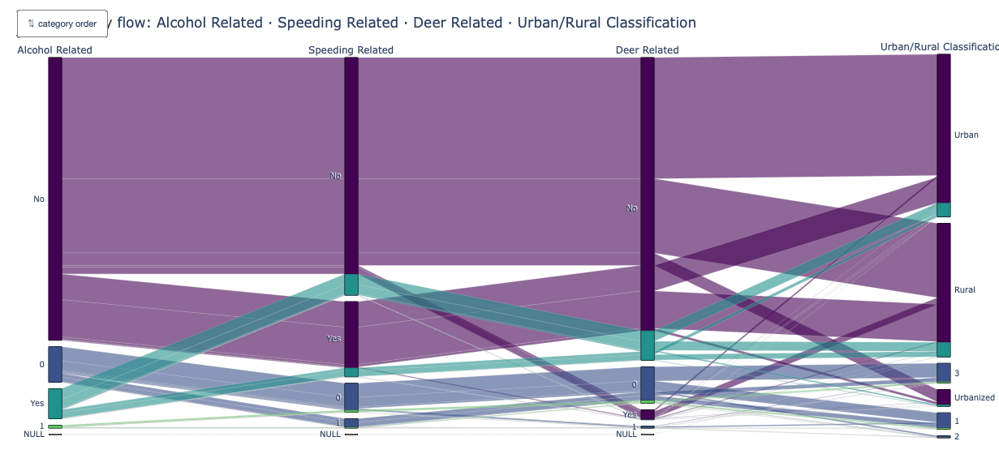 

### bird flu
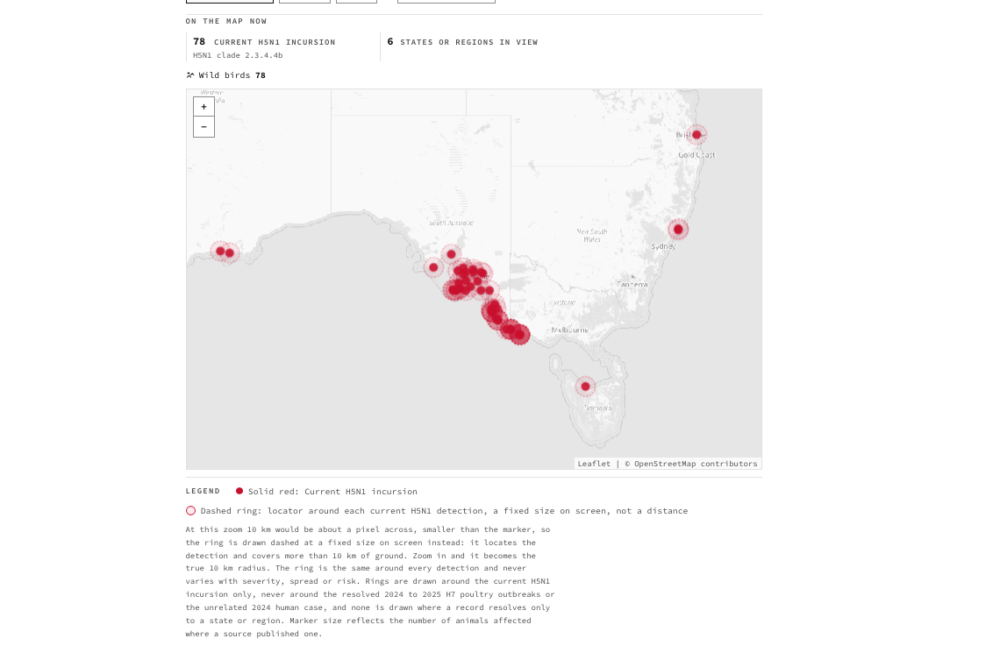 

### bird flu live
[bird flu live](https://www.birdflutracker.org)

:::
 
  
 
 

## Explanatory depth > NEPSS 

::: {.panel-tabset}

### Salmonella 
NEPSS  
  
 
### Lizards 
  
 
### Nippy's OJ
   
 
:::

## Explanatory Depth> Wildlife Hospitals

## Explanatory depth > Wildlife Carers

 
- frequently first on scene
- local experts   
	-  aware of patterns  (often unreported)
	- nuances (powls /  wombats)
- taxon experts

## Basic Solution

- ALA
- Syndication  
- Data format

# Bibliography {.unnumbered}

::: {#refs}

:::

